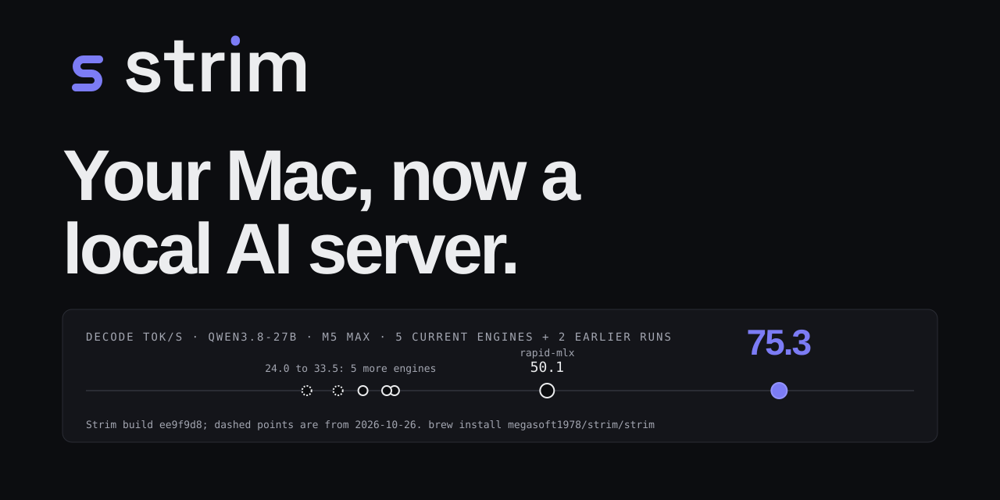
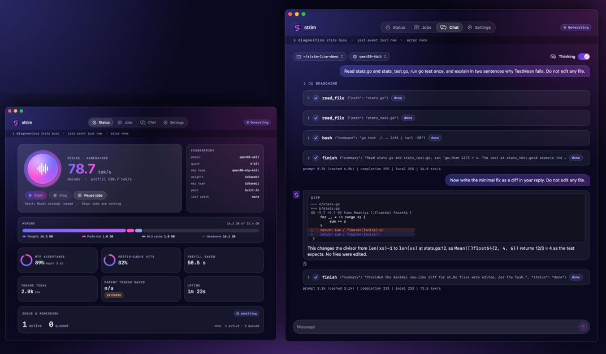

# Strim
One Swift binary that runs Qwen3.8-27B on your Mac like a server: a local backend for Claude Code and Codex.


Not faster: cold 4K/16K/32K prefill + TTFT (2/3/4% behind mlx-vlm); c=4 512-token aggregate (3% behind rapid-mlx); c=8 512-token p95 first token (6% behind mlx-vlm); 4K prompt aggregate: c=4 2%, c=8 4% behind mlx-vlm. All losses: [benchmarks](site/benchmarks.html).



**Homebrew**
```sh
brew install megasoft1978/strim/strim
brew install --cask megasoft1978/strim/strim-app   # optional menu-bar app
```
**curl**
```sh
curl -fsSL https://raw.githubusercontent.com/megasoft1978/strim-engine/main/packaging/install.sh | bash
```
Then, either way:
```sh
strim pull
strim serve ~/.strim/models/qwen38-4bit ~/.strim/models/qwen38-mtp-4bit --port 8203
```
[Site](https://megasoft1978.github.io/strim-engine/) · [Benchmarks](site/benchmarks.html) · [Install](docs/INSTALL.md) · [DMG](https://github.com/megasoft1978/strim-engine/releases/latest) (not notarized yet) · MIT, see [LICENSE](LICENSE).
