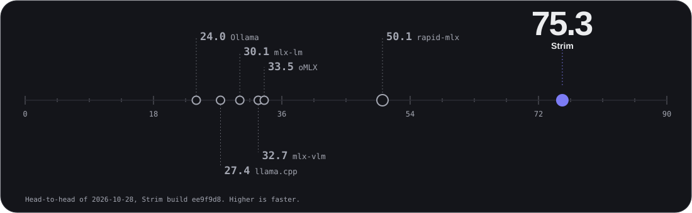

# Strim

**Run Qwen3.8-27B on your Mac like a server. One Swift binary, a local backend for Claude Code and Codex.**

  



*Own benchmark against rapid-mlx and mlx-vlm: Qwen3.8-27B 4-bit, 64 GB M5 Max (the only machine tested), medians of 2 passes ([raw results](bench/results/h2h-final2-20261028/results.json)).*

```sh
brew install megasoft1978/strim/strim
strim pull        # Qwen3.8-27B 4-bit + MTP head, about 15 GB, resumable
strim serve ~/.strim/models/qwen38-4bit ~/.strim/models/qwen38-mtp-4bit --port 8203
```

Then point Claude Code at `ANTHROPIC_BASE_URL=http://127.0.0.1:8203`; the bearer token is in `~/.strim/token`. Other install paths and Codex: [INSTALL](docs/INSTALL.md), [CLIENTS](docs/CLIENTS.md).

- **48-50% faster decode** than rapid-mlx, and 2.1-2.3x the speed of mlx-vlm. At 4K: 70.72 vs 47.75 vs 30.69 tok/s.
- **2.8-2.9x faster for agents sharing a prefix** with four clients on one 16K prefix. Median first token 20.71 s vs 75.08 s and 70.93 s.
- **30-55% lower median first token** at 4 to 8 concurrent requests, against each rival.

Not faster: cold prefill is at or within 2% of the best rival at 4K and 16K, 5% behind it at 32K; aggregate throughput at 4 to 8 concurrent requests trails the best rival by more than 2% in 3 of 6 cells (5-6%); p95 first-token latency is more than 2% worse in 2 of 6 cells (5-7%).

> Preliminary results: 6 of 6 engine sessions were measured while other jobs loaded the machine (highest 1-minute load 11.8); a clean rerun is in progress. Direction matches the earlier interleaved run. [Earlier run summary](bench/results/h2h-final-20261028/summary.md).

| Measurement | Strim | rapid-mlx | mlx-vlm | vs rapid-mlx | vs mlx-vlm |
|---|---:|---:|---:|:---:|:---:|
| Decode at 4K context (tok/s) | **70.72** | 47.75 | 30.69 | WIN | WIN |
| 4 agents on a shared 16K prefix (tok/s) | **9.553** | 3.27 | 3.45 | WIN | WIN |
| Cold 32K prompt: first token (s, lower is better) | 38.04 | 36.61 | **36.25** | LOSS | LOSS |
| 8 agents at once: total throughput (tok/s) | 28.94 | 26.95 | **30.78** | WIN | LOSS |

[Every cell and the method](site/benchmarks.html) · [Install](docs/INSTALL.md) · [Clients](docs/CLIENTS.md) · [Architecture](docs/ARCHITECTURE.md) · [Benchmarking](docs/BENCH.md) · [Security](SECURITY.md)

MIT, see [LICENSE](LICENSE). Third-party notices: [NOTICE](NOTICE).
