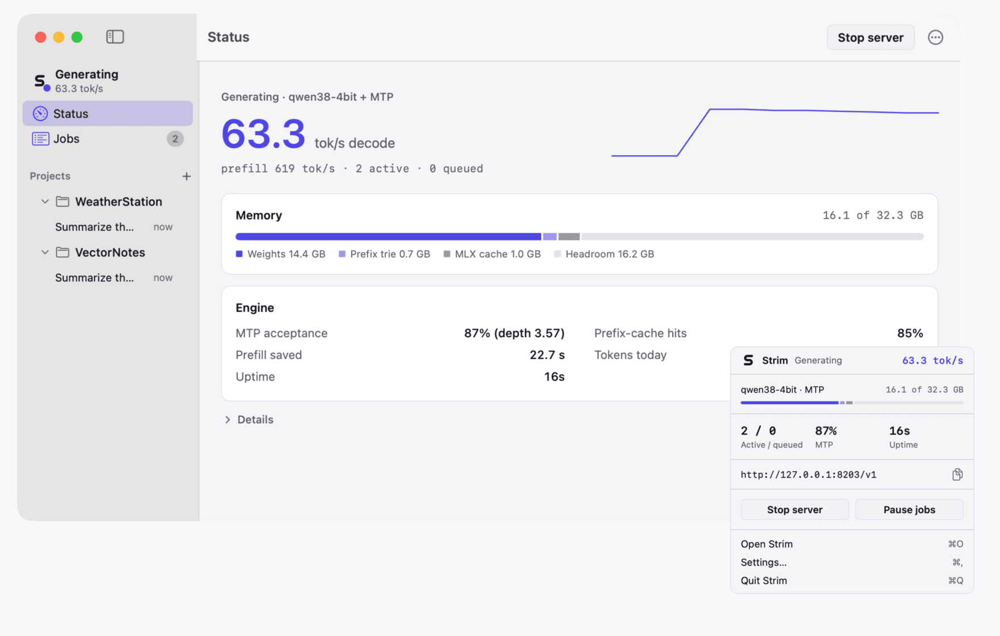
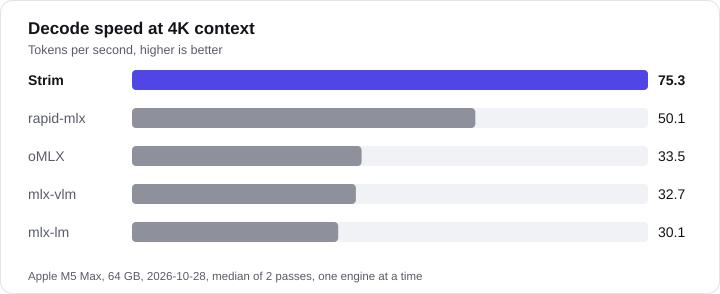

<p align="center"><picture>
<source media="(prefers-color-scheme: dark)" srcset="site/assets/readme/wordmark-dark.svg">
</picture></p>
<p align="center"><b>The local model server built for coding agents.</b><br>Qwen3.8-27B on Apple silicon. One Swift binary, a menu-bar app, nothing leaves your Mac.</p>
<p align="center">
<a href="https://github.com/megasoft1978/strim-engine/releases/latest"></a>
<a href="LICENSE"></a>

</p>
<p align="center"><a href="https://megasoft1978.github.io/strim-engine/">Website</a> · <a href="https://megasoft1978.github.io/strim-engine/benchmarks.html">Benchmarks</a> · <a href="docs/INSTALL.md">Install guide</a> · <a href="https://github.com/megasoft1978/strim-engine/releases">Releases</a></p>

<p align="center"><picture><source media="(prefers-color-scheme: dark)" srcset="site/assets/app/readme-hero-dark.png">
</picture></p>
<p align="center"><sub>Live capture on Apple M5 Max, 64 GB, while 2 agent jobs were running. The benchmarks below run one request at a time.</sub></p>

## Install
```sh
brew install megasoft1978/strim/strim              # CLI
brew install --cask megasoft1978/strim/strim-app   # optional menu-bar app (includes the CLI)
strim pull                                         # downloads the model
```
Or the [DMG](https://github.com/megasoft1978/strim-engine/releases/latest) (not notarized yet: right-click, then Open). macOS 14+, Apple silicon.

## Use it with Claude Code or Codex
```sh
strim serve ~/.strim/models/qwen38-4bit ~/.strim/models/qwen38-mtp-4bit --port 8203
export ANTHROPIC_BASE_URL=http://127.0.0.1:8203
export OPENAI_BASE_URL=http://127.0.0.1:8203/v1
```

## Benchmarks
<p align="center"><picture><source media="(prefers-color-scheme: dark)" srcset="site/assets/readme/decode-dark.svg"></picture></p>

| Workload | Strim | Best other engine | Ratio |
|---|---:|---:|---:|
| Decode, 4K context (tok/s) | 75.3 | 50.1 (rapid-mlx) | **1.50x** |
| 4 agents, shared 16K prefix (tok/s) | 9.77 | 3.47 (mlx-vlm) | **2.81x** |
| Peak memory, whole run (GB, lower is better) | 30.8 | 35.9-37.5 | **1.17x** |
| Cold 32K prompt, first token (s, lower is better) | 37.1 | 35.5 (mlx-vlm) | 0.96x, slower |
| 4 concurrent requests, aggregate (tok/s) | 69.2 | 71.7 (rapid-mlx) | 0.97x, slower |
| 8 concurrent requests, aggregate (tok/s) | 76.4 | 74.7 (mlx-vlm) | **1.02x** |

<sub>Apple M5 Max, 64 GB, macOS 27.0.1, Qwen3.8-27B 4-bit, one engine at a time, median of 2 passes, 2026-10-28, build ee9f9d8. Ratio above 1 means Strim is better. Not a fit if you want many models or a model browser: use Ollama or LM Studio. [Every cell and method](https://megasoft1978.github.io/strim-engine/benchmarks.html) · [raw data](bench/results/h2h-final3-20261028) · MIT · Not affiliated with Qwen, Alibaba or Apple.</sub>
