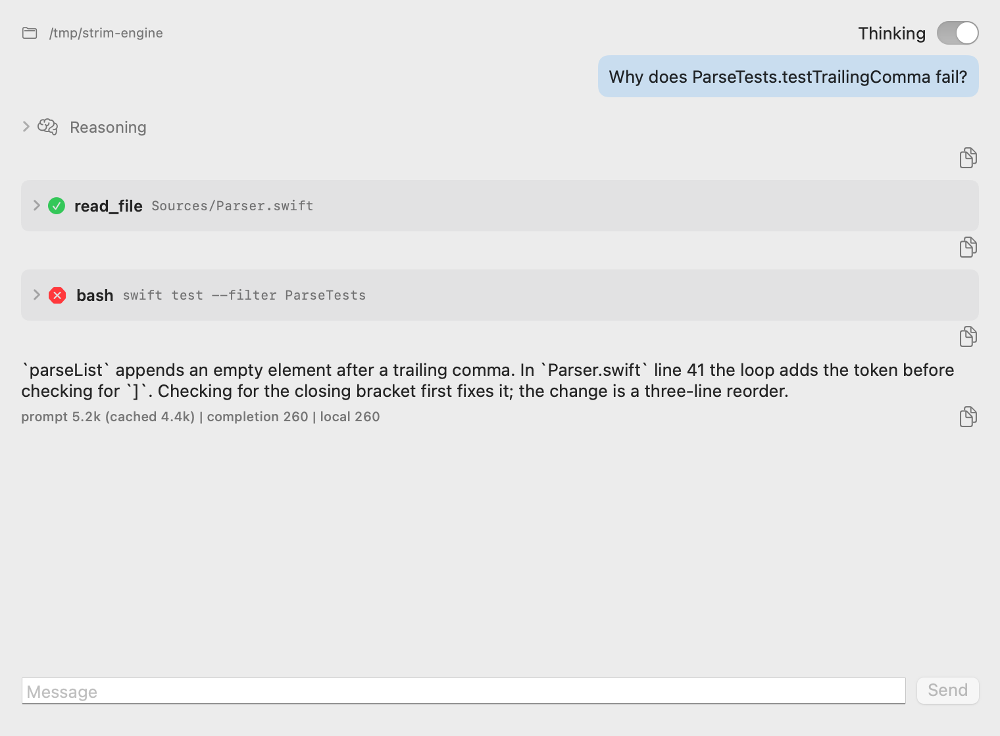
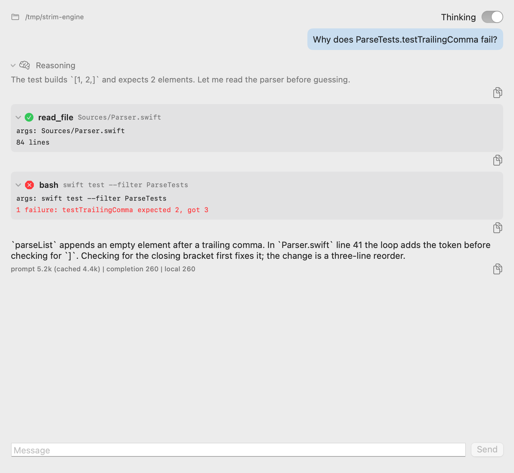
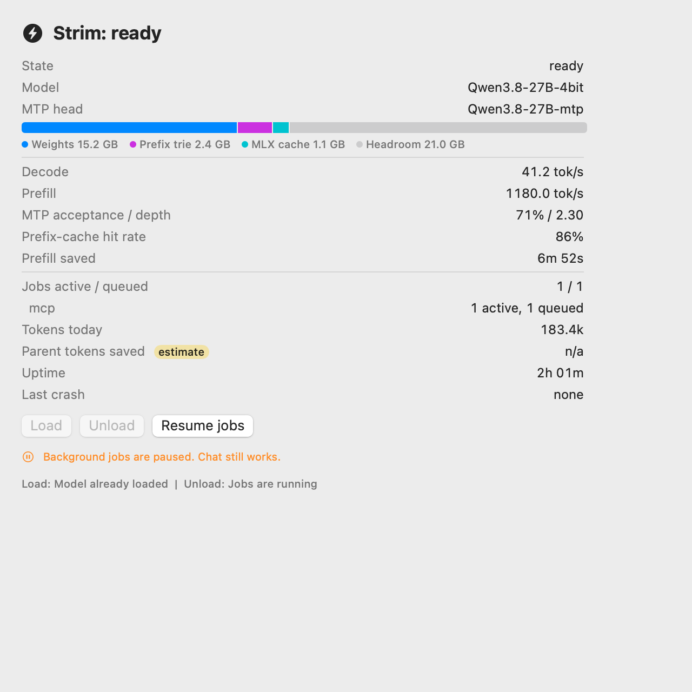
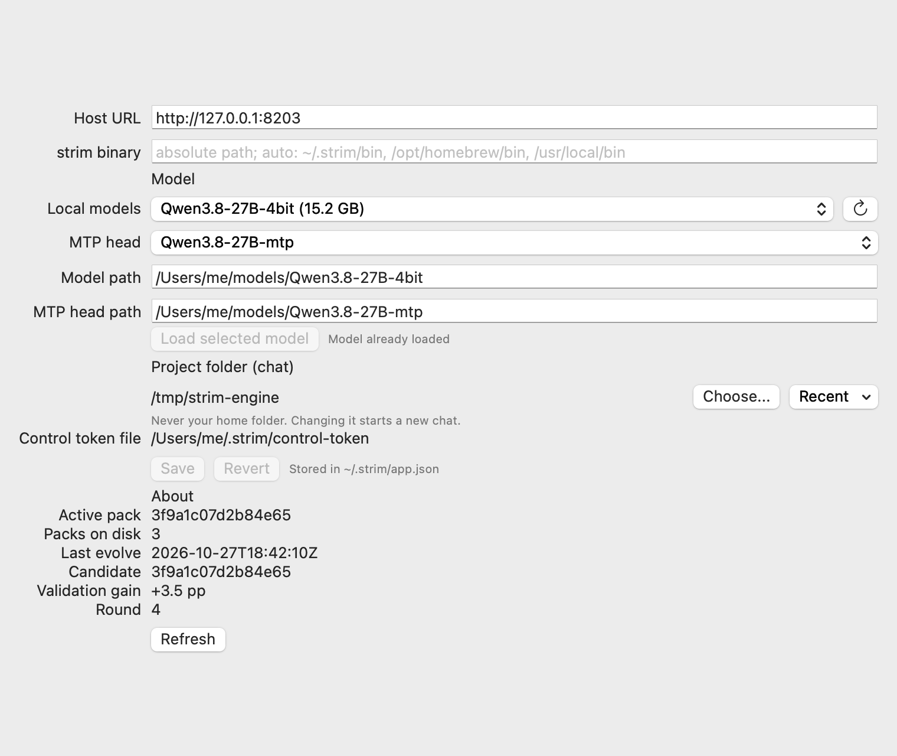

# Strim menu-bar app

SwiftUI `MenuBarExtra` (LSUIElement) and a main window. A thin client of the host: it links only `StrimAppCore` and `StrimAPI`, never MLX or `StrimEngine`. Wire contract: `docs/CONTROL-API.md`.

## Targets
- `StrimAppCore` (library): `HTTPControlClient` (URLSession, bearer from the token file, SSE parser, typed `ControlClientError`), `AppModel` (state machine), `StatsFormat`, `OfflineBanner`, `DiffParser`, `AppSettings`, service protocols (`HostLauncher`, `McpCommandProvider`, `LoginItemControlling`, `ClipboardWriting`, `AppClock`).
- `StrimApp` (executable): views only.
- Tests: `Tests/StrimAppCoreTests` (swift-testing; `FakeControlClient`, a `URLProtocol` stub for HTTP and SSE, an injected clock).

## State machine
`connecting -> connected(status) -> disconnected(reason) -> (backoff 1,2,4,8,16,30,30... s) -> connecting`.
- Backoff resets after a successful status fetch. "Retry now" and a successful "Start host" reconnect immediately.
- While connected: one SSE stream (`status`, `job_event`, `harness_event`, `chat_delta`, `error`) plus a 5 s status poll (throughput numbers change without state changes, and the poll detects a dead host on an idle stream). Either failing disconnects.
- Unknown SSE event types are skipped.

## What each state shows
Menu bar item is always an SF Symbol plus text, never blank:
| State | Symbol | Text |
|---|---|---|
| host not reachable | bolt.slash | `Strim: offline` |
| first connect / retry | arrow.triangle.2.circlepath | `Strim: connecting` |
| host `stopped` | stop.circle | `Strim: stopped` |
| host `loading` | hourglass | `Strim: loading 42%` |
| host `ready` | bolt.circle.fill | `Strim: ready` |
| host `busy` | bolt.horizontal.circle.fill | `Strim: busy` |
| host `error` | exclamationmark.triangle.fill | `Strim: error` |

Offline: orange banner with the exact reason (connection refused, timeout, 401 with or without token file, 403, stream closed), "Start host" and "Retry now". "Start host" runs `strim serve <model_path> [mtp_path] --port N` as a detached child logging to `~/.strim/host.log` (binary from `strim_binary`, else `~/.strim/bin`, `/opt/homebrew/bin`, `/usr/local/bin`). If the binary is missing the command is copied to the clipboard with a notice to paste it in Terminal; if `model_path` is unset the notice says so. No login is required.

Connected: stats block (state, model, MTP head, stacked memory bar weights/prefix trie/MLX cache/headroom, decode and prefill tok/s, MTP acceptance and depth, prefix-cache hit rate, prefill seconds saved, active/queued jobs with per-source rows, tokens today, parent tokens saved tagged "estimate", uptime, last crash), Load/Unload (disabled with a reason shown in the tooltip and a caption), "Pause jobs" / "Resume jobs" (`POST pause|resume`: background jobs are not admitted while paused, running ones finish, chat is never blocked; the state comes from `status.jobs_paused` and a caption says when paused), Copy MCP registration commands, Launch at login (SMAppService.mainApp), Open Window, Quit.

## Window
Tabs: Status (same stats, larger), Jobs (list, detail, verify badge, diff view with line numbers, Apply/Reject calling `POST /jobs/approve`; enabled only for an `awaiting_approval` job with a patch; "Cancel job" calls `POST jobs/cancel` and is disabled for finished jobs), Chat, Settings.

### Chat
Opens a session in the project folder (`ProjectFolder.resolve`: never home or a parent of it; a 501 shows "Chat not available yet").
- Tool calls are cards: status icon, tool name and a one-line args summary, collapsed by default; expanding shows the args and the result (errors in red). A `tool_result` delta is paired with the oldest unfinished card of the same name.
- Reasoning is a collapsed "Reasoning" disclosure group per block, separate from the answer.
- Per-turn token ledger under the last message of a turn: prompt (cached), completion, local tokens (what the local model generated) and tok/s over the turn, from the `harness_event` `usage` frames (`prompt/cached/completion`, summed over the turn's steps) and the client clock. tok/s includes tool time, so it understates decode speed.
- Thinking switch (default on): sent as `enable_thinking` on open and on every append. The harness chat backend must implement `ChatBackend.setThinking` for it to take effect; until then hosts ignore it.
- Stop button (Cmd-.) replaces Send while a turn runs (`chat/cancel`); a second message is not sent while a turn runs; a dropped connection ends the turn. Copy button on every message (tool cards copy name, args and result).
- Smooth streaming: text and reasoning deltas are coalesced and applied about 30 times a second, the transcript is a lazy stack scrolled without animation.

### Settings
Host URL, binary, then the pickers; token path read-only; saved to `~/.strim/app.json`.
- Model picker: lists `GET models` (directories with a `config.json` under the host's model roots); on a host without the route the app scans `~/.strim/models` and `~/models`. Choosing a model or MTP head only writes `model_path` / `mtp_path`; nothing loads until the Load button (Status tab or here). With another model loaded the note says to Unload, then Load.
- Project picker: "Choose..." (NSOpenPanel, folders only) and a "Recent" menu (last 8, newest first, stale ones hidden), both validated by `ProjectFolder.resolve`; a rejected folder leaves the settings untouched and shows the reason. Choosing one starts a new chat.
- About: active pack fingerprint, packs on disk and the last `strim evolve` record (candidate fingerprint, round, validation gain in pp, dry run flag, time) from `GET pack`, read-only.

### Approval safety
`DiffParser.analyze` keeps every line of a patch: header lines (index, modes, rename/copy, similarity, `---`/`+++`, binary) become tagged rows, unknown lines become visible "UNEXPECTED" rows, and hunk bodies are counted against their `@@` headers. The file list with change kinds (modified, added, deleted, renamed, copied, mode change, symlink, binary), totals from the parsed data and the patch byte size sit above the hunks.
- Blocking (Apply never offered, Reject and "Copy patch path" only): hunk count mismatch, stray or unknown lines, content before the first `diff --git`, malformed hunk header, NUL or invalid UTF-8, no file sections.
- Suspicious but confirmable: path with quotes, control characters, `..`, absolute path or a `.git` component; `---`/`+++` paths that disagree with the `diff --git` line; symlink target absolute or containing `..`.
- Special (Apply disabled until the confirmation box naming it is ticked, e.g. "This patch adds a symlink and makes a file executable"): symlink, mode or exec-bit change, submodule, binary, rename or copy, paths that run on open, commit or build (`.vscode/`, `.envrc`, `.husky/`, `.githooks/`, `.github/`, `scripts/`, Makefile, `package.json`, `Package.swift`, `pyproject.toml`, `setup.py`, `conftest.py`, `.gitattributes`, `.gitmodules`, `.npmrc`, Dockerfile, `.pre-commit-config.yaml`; they are named in the confirmation). Hidden characters (control, format/bidi/zero-width, default-ignorable, variation selectors, and the filler/blank set U+115F U+1160 U+3164 U+FFA0 U+2800 U+034F U+180E) in paths or code lines are shown as `\u{..}` escapes and make the patch suspicious (tick required). Non-ASCII spaces (NBSP, U+1680, U+2000-200A, U+202F, U+205F, U+3000) are suspicious in paths but only a soft note in code lines (no tick), to avoid noise from legitimate non-breaking spaces in prose and strings. Paths and `diff --git` vs `---`/`+++` names are compared byte-wise (Swift `==` treats canonically equivalent Unicode as equal), and a path not in NFC form is flagged.
Binary sections are parsed as git does (`literal N`/`delta N`, length-checked base85 lines, blank terminator, at most two hunks); anything else inside one, including `---`, `+++`, `@@` or `diff --git`, is a blocking stray line. Modes are normalised like git (octal, trimmed, integer compare); only 100644, 100755, 120000 and 160000 are accepted, any other or unparseable mode blocks Apply.
Approval is bound to content: the app computes SHA-256 over the exact patch bytes it analysed and shows, sends it as `patch_sha256` with `apply`, re-fetches the job right before sending and aborts if the digest changed, and after a background refresh that changes the patch it disables Apply until the user acknowledges the updated patch (ticks do not carry over). The server must enforce the digest (see `docs/CONTROL-API.md`).
The tick resets when the selected job or its patch changes. "Copy patch path" writes the patch to `~/.strim/patches/<job>.patch` and copies the path.

TEST BANNER at the top of the window when `STRIM_APP_TEST=1` or when connected to a host whose state is not `ready`: raw state, last event time, last error, last 12 event-log lines. With `STRIM_APP_TEST=1` the window also opens at launch.

## Settings file `~/.strim/app.json`
```json
{"host_url":"http://127.0.0.1:8203","strim_binary":"/opt/homebrew/bin/strim","model_path":"/path/to/model","mtp_path":"/path/to/mtp","token_path":"~/.strim/token"}
```
All keys optional; `app.json` is written 0600 in a 0700 `~/.strim`. Also `control_token_path` (default `~/.strim/control-token`; must be inside the home folder, a regular non-symlink file owned by you; a banner warns when group/world readable or missing), `project_path` (the folder chats work in; chat is not offered without one and never uses `$HOME`) and `recent_projects` (the picker's recents). The control token is read per request and is never displayed or logged; the MCP token `~/.strim/token` is not used by the app (MCP commands only reference `$(cat ~/.strim/token)`).
`host_url` must be `http://127.0.0.1:<port>`, `http://localhost:<port>` or `http://[::1]:<port>` (no userinfo, path, query, fragment); anything else makes every call fail closed with a banner. The client uses an ephemeral session with no proxies, cache or cookies, and refuses redirects. `strim_binary` must be an absolute, normalised path to an existing executable regular file that is not world-writable; otherwise it is not run and the command is shown/copied. `host.log` and patches under `~/.strim/patches` are 0600 in 0700 directories.

## Build and run
```
scripts/make_app.sh                      # release build -> dist/Strim.app, ad-hoc signed
CONFIG=debug SCRATCH=/tmp/x SMOKE=1 scripts/make_app.sh   # debug build, 2 s headless launch check
swift test --filter StrimAppCoreTests
```
Not verified without a screen: layout, menu-bar width with the text label, popover sizing, window auto-open in test mode, SMAppService behavior for an ad-hoc signed app.

## Screenshots
Rendered headlessly from sample data (a scripted `FakeControlClient`, no host or network; paths are placeholders) by the app itself: `STRIM_APP_SNAPSHOT_DIR=docs/img .build/debug/StrimApp` writes `app-*.png` and exits. They show real AppKit controls but an inactive window (switches look grey) and no tab bar or menu bar.

| | |
|---|---|
| Chat, cards collapsed: `docs/img/app-chat.png` | Chat, cards expanded: `docs/img/app-chat-expanded.png` |
| Status with jobs paused: `docs/img/app-status.png` | Settings (model and project pickers, pack info): `docs/img/app-settings.png` |





